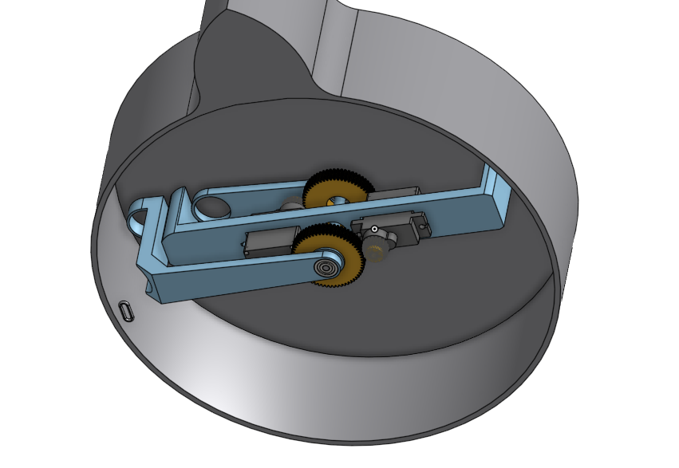
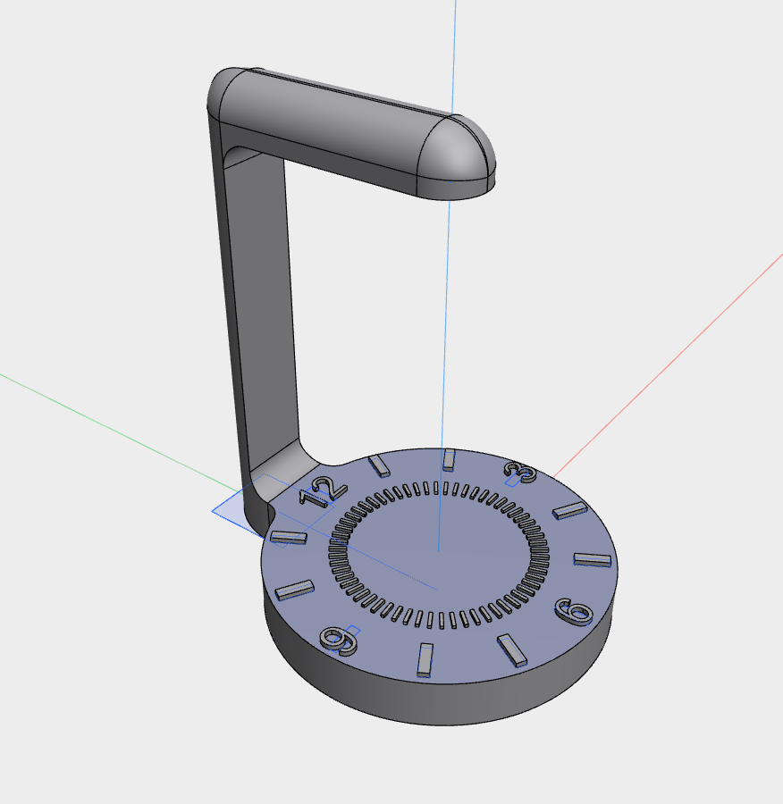
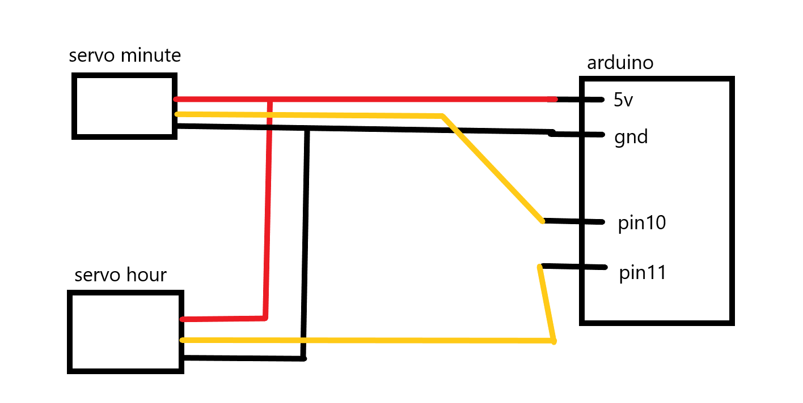

# Gravitime

## Hello, and welcome to my project, Gravitime!
This is a wierd clock using magnets and pendulums to show the time.

### How it works
Gravitime uses a hidden mechanism under the watchface, that drags two magnets really close to the watchface, to attract two metal balls hanging from above.

*Bottom view*

*Ball holder*

*Stand*

### Why I made it
I really enjoy both magnets, and pendulums soo...

### Crucial information:
- I used the following spline model to make "gear 20 teeth": "https://cults3d.com/en/3d-model/various/micro-servo-sg90-attachment-gear"

*Stl folder only contains files that need to be 3d printed. (Not the servos, bearings)
### Print settings
- Use your preferred printer's basic settings (Like: https://craftlayerindia.com/blogs/3d-printer-settings/best-pla-settings-for-3d-printing)
- Enable tree supports
- Split the base int two parts, the bottom and the top and glue it together. (or print it in one if your printer supports it)
- Print all other files as you wish, in batches or individually

### Assembly
*Assuming the base is already in one piece*
- Press fit the bearings and magnets into the arms
- Assemble the mechanic under the clock according to Assembly.step (After placing the servodistance keeping rod, slide the servo bridge on, and glue it to the base before attaching the hour hand)
- Assemble the top part also according to Assembly.step
- Cut two strings and glue it into the metal balls, just so it barely doesn't reach the surface of the clock
- tie the strings with the balls to the top rotating assembly

### Wiring and driving the servos
I've chosen an arduino r4 uno to power theese servos, as they can be wired directly to the arduinos pins.
- Wire the servos red and black to the arduino r4 uno's 5v (red) and gnd (gnd) pins.
- Wire the minute hand servo's data line (yellow) to arduino pin 10
- Wire the hour hand servo's data line (yellow) to arduino pin 11
- **Power the arduino using usb-c (at least 10W)**
- Upload the code in "software" to the arduino.

Simplified wiring guide.

Information:
- Clock needs to be set to the correct time when starting, due to the fact that endless servos do not have an end position sensor.
- Software might need tweaks, guided in the software file.

