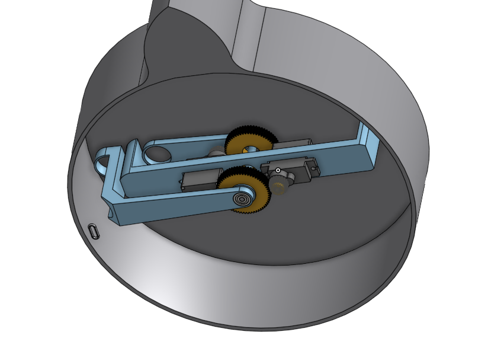
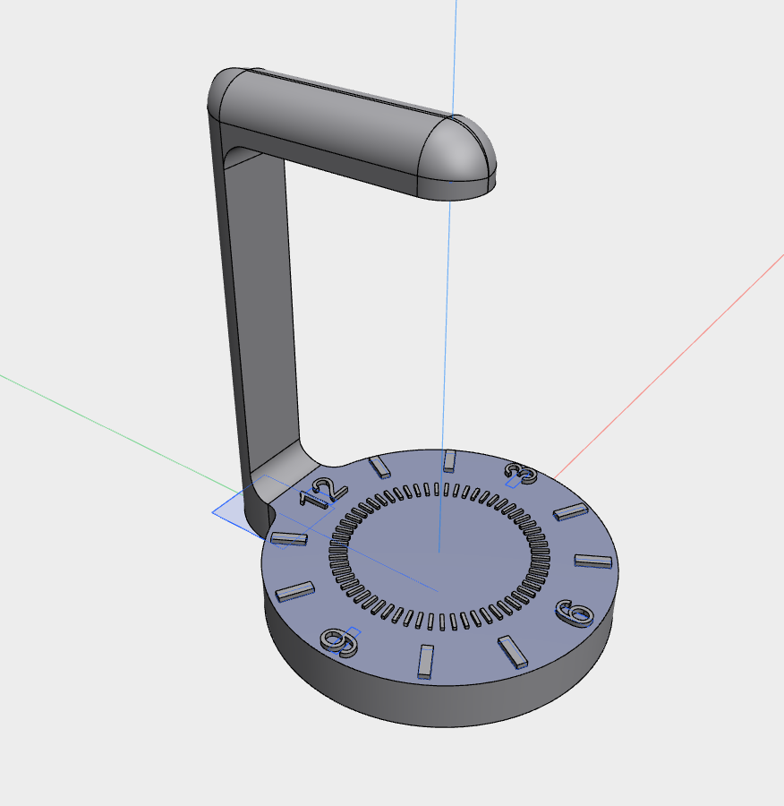

# Gravitime

## Hello, and welcome to my project, Gravitime!
This is a wierd clock using magnets and pendulums to show the time.

### How it works
Gravitime uses a hidden mechanism under the watchface, that drags two magnets really close to the watchface, to attract two metal balls hanging from above.

*Bottom view*

*Ball holder*

*Stand*

### Why I made it
I really enjoy both magnets, and pendulums soo...

### Crucial information:
- You need to drive the servos with a microcontroller, that is not included in the plans.
- I will make the program for it, when the parts arrive.
